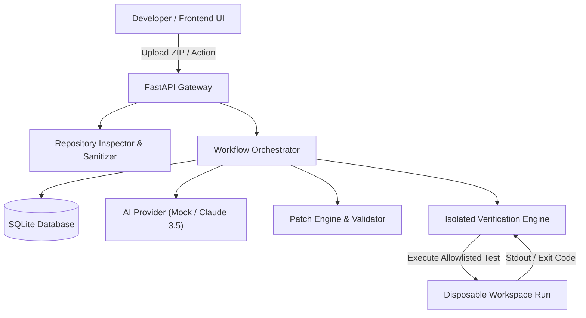

# Architecture Specification — CodePilot AI

## 1. System Overview

CodePilot AI is an autonomous AI-assisted software engineering platform designed to inspect repositories, diagnose bugs, generate atomic unified diff patches, create regression test suites, and execute sandboxed verification runs.

---

## 2. Core Subsystems

### 2.1 Repository Inspector & Sanitizer (`inspector.py`, `sanitizer.py`)
- **Safe ZIP Extraction**: ZipSlip canonical boundary validation protects against path traversal.
- **Language & Manifest Detector**: Identifies Python, TypeScript, JavaScript, Rust, Go, Java, along with build tools (`pyproject.toml`, `package.json`, `Cargo.toml`).
- **Sanitized Tree Builder**: Recursively builds a clean file tree, excluding `.git`, `node_modules`, virtual environments, caches, binaries, and sensitive configuration files.
- **Deterministic Code Locator**: Tokenizes bug descriptions and locates matching identifiers, AST functions, and line boundaries without relying on external vector databases.

### 2.2 Bug Analysis Agent (`orchestrator.py`, `ai/`)
- Accepts a developer bug description and relevant deterministic code context.
- Separates observed evidence snippets from architectural hypotheses.
- Outputs a structured finding: severity (`low`, `medium`, `high`, `critical`), confidence score (0.0 to 1.0), suspected root cause, and affected file references with exact line ranges.

### 2.3 Patch Generation & Validation Engine (`patch_engine.py`)
- Produces clean unified diffs (`--- a/... +++ b/... @@ ... @@`).
- Validates that target paths strictly reside within the designated workspace.
- Implements dry-run application to verify hunk applicability before disk modification.
- Requires explicit user approval before applying changes, with atomic rollback on error.

### 2.4 Regression Test Agent (`ai/`)
- Synthesizes runnable tests exercising the diagnosed edge condition.
- Explains the target assertion and reproduction rationale.
- **Inviolable Rule**: Explicitly flags generated tests as `UNVERIFIED` until physically passed in the sandbox.

### 2.5 Verification Engine (`verifier.py`)
- Spawns an isolated disposable copy of the repository in `data/sandbox/run_<id>`.
- Enforces a strict command allowlist (`pytest -v`, `python -m pytest`, `npm test`) with `shell=False`.
- Runs baseline reproduction (verifies the test fails on unpatched code) and patched verification (verifies test passes with exit code 0).
- Captures wall-clock duration in milliseconds, exit code, stdout, and stderr.
- Automatically cleans up the disposable workspace upon execution.

### 2.6 State Machine Orchestrator (`orchestrator.py`)
Tracks state transitions:
`uploaded` &rarr; `indexed` &rarr; `analyzing` &rarr; `analyzed` &rarr; `patch_ready` &rarr; `awaiting_verification` &rarr; `testing` &rarr; `verified` (or `failed`).

---

## 3. Database Schema

The SQLite database consists of 6 normalized relational entities:
1. `projects`: id, name, storage_path, file_count, total_size_bytes, languages, manifests, test_frameworks, created_at.
2. `analysis_sessions`: id, project_id, status, bug_description, target_file, created_at, updated_at.
3. `bug_findings`: id, session_id, severity, confidence, suspected_root_cause, explanation, evidence, affected_files, created_at.
4. `proposed_patches`: id, session_id, diff_content, affected_files, rationale, status, is_approved, is_applied, approved_at, created_at.
5. `regression_tests`: id, session_id, file_path, test_code, test_framework, test_rationale, assertion_description, is_verified, created_at.
6. `verification_runs`: id, session_id, command, exit_code, duration_ms, stdout, stderr, is_verified, baseline_exit_code, baseline_output, status, summary, created_at.
