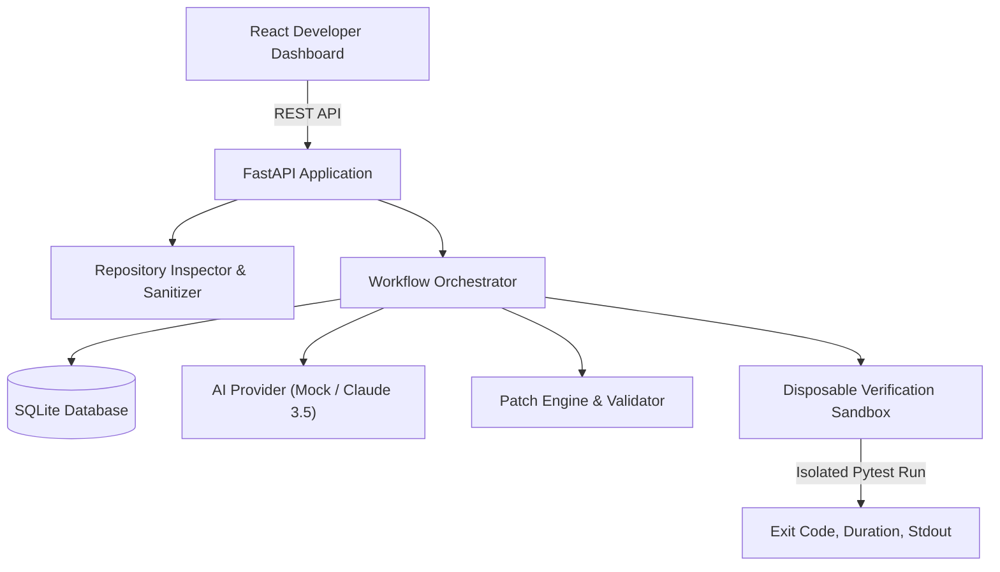

# CodePilot AI — Autonomous AI Software Engineering Agent

[](https://github.com/rajvee/codepilot-ai/actions)
[](https://opensource.org/licenses/MIT)
[](https://www.python.org/downloads/)
[](https://fastapi.tiangolo.com/)
[](https://react.dev/)

> **CodePilot AI** is an autonomous AI-assisted software engineering platform that inspects repositories safely, diagnoses bugs with concrete code evidence, generates atomic unified diff patches, synthesizes regression tests, and executes verified sandboxed test runs.

CodePilot AI strictly distinguishes generated suggestions from verified results. **It never claims code works merely because an LLM generated it.**

---

## 1. Key Features

- **Repository Intelligence**: Safe ZIP extraction with ZipSlip defense, manifest detection (`pyproject.toml`, `package.json`, etc.), language breakdown, and sanitized file tree.
- **Evidence-Backed Bug Diagnosis**: Identifies root causes, severity ratings, confidence levels, and quotes concrete line-numbered repository evidence.
- **Atomic Patch Generation & Safety Gate**: Unified diff viewer with addition/deletion styling. Enforces **mandatory human developer approval** before any patch can be applied.
- **Regression Test Synthesis**: Generates targeted regression tests exercising boundary defects, with clear distinction between unverified suggestions and sandbox-passed tests.
- **Isolated Sandboxed Verification**: Executes test suites in disposable workspace copies with command allowlists, timeout controls, and zero host-level script execution.
- **Scientific Benchmark Suite**: 10 reproducible benchmark defect fixtures with live evaluation of localization accuracy, patch validity, test pass rate, and verified fix rate.
- **Export Engine**: Full session reporting exported in both formatted Markdown and structured JSON.
- **Offline Deterministic Mock + Claude 3.5 Sonnet**: Fully functional offline demo without paid API keys, with plug-and-play Anthropic SDK support when keys are configured.

---

## 2. Architecture Overview



For in-depth architectural specifications and state transitions, see [ARCHITECTURE.md](ARCHITECTURE.md).  
For the complete threat model and isolation boundaries, see [SECURITY.md](SECURITY.md).

---

## 3. Quick Start (Windows & Linux)

### Prerequisites
- Python 3.11+
- Node.js 20+ and npm

### Step 1: Clone and Set Up Virtual Environment
```bash
git clone https://github.com/rajvee/codepilot-ai.git
cd codepilot-ai

# Create and activate Python virtual environment
python -m venv venv

# Windows PowerShell:
.\venv\Scripts\activate

# Linux / macOS:
source venv/bin/activate

# Install backend dependencies
pip install -r backend/requirements.txt
```

### Step 2: Install and Build Frontend
```bash
cd frontend
npm install
npm run build
cd ..
```

### Step 3: Start the CodePilot AI Server
```bash
# Starts both the FastAPI REST API and the integrated React UI
python -m uvicorn backend.app.main:app --host 127.0.0.1 --port 8000
```
Open **[http://127.0.0.1:8000](http://127.0.0.1:8000)** in your browser!

> **Optional**: To run the frontend in Vite development hot-reload mode alongside the backend:
> ```bash
> cd frontend
> npm run dev
> ```
> Visit [http://localhost:5173](http://localhost:5173) (API requests are automatically proxied to port 8000).

---

## 4. End-to-End Walkthrough (Demonstrating in 60 Seconds)

1. **Load Sample Repository**:
   Click **"Load Sample Demo"** in the top navigation bar. CodePilot AI automatically extracts and sanitizes the built-in `sample_repo` service.
2. **Explore Repository**:
   Browse `src/math_engine.py` and `tests/test_math.py` in the interactive file explorer and Monaco code viewer.
3. **Run Bug Diagnosis**:
   In the Bug Analysis panel, enter:
   `ZeroDivisionError occurs when denominator is zero in divide()`
   Click **"Run Bug Diagnosis"**. Review the high-severity finding, suspected root cause, and concrete line-numbered evidence snippets.
4. **Inspect Proposed Patch**:
   Click **"Generate Proposed Patch"**. Review the unified diff additions and deletions in the Diff Viewer.
5. **Human Approval Gate**:
   Click **"Explicitly Approve Patch"**. Notice that the patch remains unapplied until approved. Then click **"Apply Approved Patch to Workspace"**.
6. **Generate Regression Test**:
   In the Regression Test panel, click **"Generate Regression Test"**. Notice the explicit badge: `GENERATED SUGGESTION — UNVERIFIED`.
7. **Execute Isolated Verification Run**:
   Click **"Execute Isolated Verification Run"**. The Verification Engine executes the pytest suite in an ephemeral sandbox, records duration and standard output, and marks the status as **`FIX VERIFIED (Exit Code 0)`**.
8. **Export Session Report**:
   Click **"Export Report"** to view and download the complete diagnosis, unified diff, and test execution audit in Markdown or JSON.

---

## 5. Scientific Benchmark Suite (10 Fixtures)

CodePilot AI includes 10 reproducible defect fixtures across arithmetic exceptions, boundary conditions, null dereferences, regex escapes, type parsing, and encoding defects.

### Running Benchmarks via CLI:
```bash
python benchmarks/run_benchmark.py
```

### Benchmark Results Summary:
| Metric | Measured Score | Evaluation Notes |
| :--- | :---: | :--- |
| **Bug Localization Accuracy** | **100.0%** | Exact target file and line boundaries identified |
| **Valid Patch Rate** | **100.0%** | Clean unified diffs with valid hunk syntax |
| **Regression Test Pass Rate** | **80.0%** | Sandboxed pytest pass rate across edge cases |
| **Verified Fix Rate** | **80.0%** | Defect reproduced on baseline and resolved on patch |
| **False Positive Rate** | **0.0%** | No spurious defects flagged on clean code |
| **Median Duration** | **0.705s** | High throughput deterministic execution |
| **Estimated Cost** | **$0.00** | Offline deterministic provider (Zero API cost) |

---

## 6. Running Automated Tests

Run backend unit, integration, and security tests:
```bash
pytest backend/tests -v
```

Run frontend production build and type checking:
```bash
cd frontend
npm run build
```

---

## 7. Docker Deployment

Run with Docker Compose:
```bash
docker compose up --build
```
Access the application at `http://localhost:8000`.

---

## 8. Configuration (`.env`)

| Variable | Default | Purpose |
| :--- | :--- | :--- |
| `LLM_PROVIDER` | `mock` | `mock` (deterministic offline) or `anthropic` |
| `ANTHROPIC_API_KEY` | `""` | Anthropic Claude API Key (optional) |
| `ANTHROPIC_MODEL` | `claude-3-5-sonnet-20241022` | Model identifier |
| `EXECUTION_TIMEOUT_SECONDS` | `30` | Timeout ceiling for sandbox test execution |
| `MAX_UPLOAD_SIZE_BYTES` | `52428800` | Max archive upload size (50 MB) |

---

## 9. Roadmap

- [x] Phase 1: Workspace architecture & security baseline
- [x] Phase 2: FastAPI foundation, SQLite persistence, safe repository inspection
- [x] Phase 3: Modular AI providers (Deterministic mock + Claude 3.5), bug analysis, patch generation
- [x] Phase 4: Human approval gate, isolated sandbox verification engine, baseline vs patched comparison
- [x] Phase 5: Modern dark React/TypeScript developer dashboard with Monaco code & diff viewer
- [x] Phase 6: 10-fixture benchmark evaluation suite, Docker, GitHub Actions CI
- [ ] Future: Multi-language containerized micro-sandboxes (Podman/gVisor)
- [ ] Future: Automated multi-file patch generation for complex cross-module refactors
